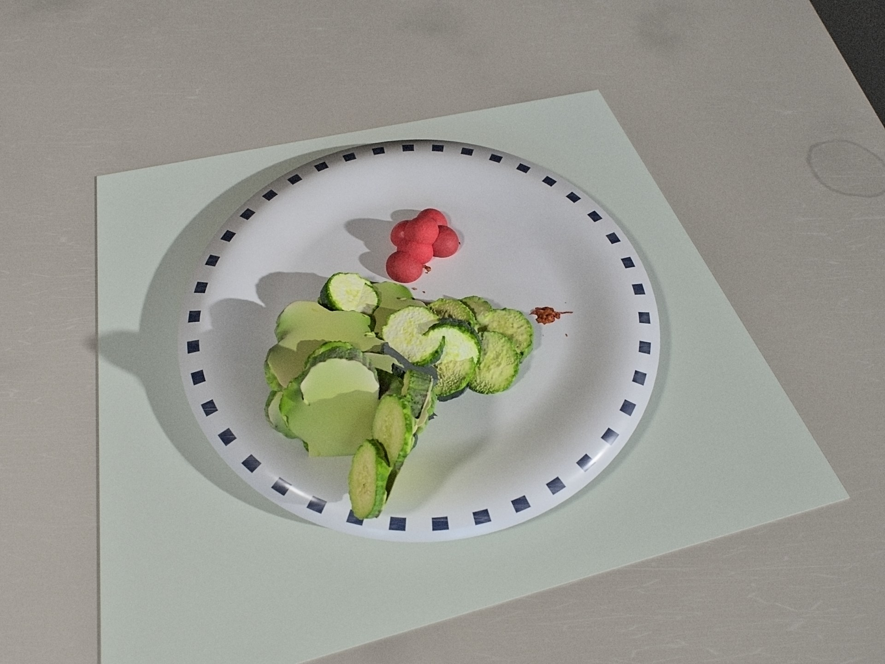

# 3D Food Segmentation: progress report, 2026-10-20

Nathaniel Ly. Advisor: Alex Wong. Drafted 2026-10-15, updated 2026-10-16 (real SAM 3 votes, density, final refiner state). Numbers cite their source file; unverified items are marked [verify], unfinished runs [pending].

## 1. Summary

The system turns an iPad scan (RGB, LiDAR, poses) into a fused metric 3D model, per-item segmentation, volume, and mass and calories via density and USDA lookup. Evidence comes from two proxies: a 2D baseline on Nutrition5k (pre-registered 16-model average 9.0% mass, 13.1% energy error; published best NuNet 8.72% / 12.80%) and simulated scans. Findings: (1) Density floor: on 548 MetaFood3D objects, 16-view carving gives 9.0% median volume error but 25.1% mass error (perfect-volume floor 24.0%). (2) The point-transformer refiner improves semantic but not instance labels over lifted SAM 3 masks (27 scans / 70 items; real votes, partial round 4, agree). (3) Segmentation is not the synthetic volume bottleneck; against the envelope a scan measures, an orbit beats one overhead frame by 26 pp item error, and density is the next error source (sections 3(f), 3(g)). We are behind schedule: no weighed meal has been captured and the 4 October collection milestone was missed. Next: real capture, density recalibration from weighed meals, then the envelope target (section 5).

## 2. Goals and research questions, with status

Source: thesis proposal (2026-10-02). Target: energy error near 13% or below.

| Goal | Status | Evidence |
|---|---|---|
| Capture app and 3D reconstruction (Sep 20-Oct 3) | Partial | App and `pipeline/foodscan` exist. One real scan, a box (`docs/reconstruction.md`). No food scans. |
| VLM naming and USDA lookup | Partial | `naming.py`, `nutrition.py` exist; no accuracy numbers. |
| RQ1: scan vs single RGB or RGB-D frame | Synthetic only; real pending | hard_v12 (177 items, GT labels, container method), envelope target: K=24 scan beats one overhead frame by 26 pp item APE [+20, +34] (24 vs 48%) and 30 pp dish (14 vs 46%); against solid volume no difference, +0 [-10, +9] (`results/rq1/envelope.md`). Real data: only 2D single-frame (`results/n5k/README.md`) and MetaFood3D carving. |
| RQ2: SAM 3 vs open-vocabulary 3D | Partial | SAM 3 lift implemented (`foodscan/segment.py`, `labels.py`), evaluated on synthetic scans (`results/seg3d/ablations.md`; real votes in 3(d)). No refiner beats the lift on instances after four rounds; decided 16 Oct: the learned instance refiner line is paused; segmentation pivots to lift quality (SAM 3 prompting, per-frame image inference, co-vote linking), validated on 40 scans in 3(d); PTv3 stays only a semantic cleaner. No Search3D code. |
| RQ3: SAM 3D completion vs plate closing | Not started | No SAM 3D code. Plane closing overestimates by +40% from one overhead view (MetaFood3D). SAM 3D needs the cluster [verify cluster status]. |
| Volume checked on known objects | Not started | `calibrate.py` exists, no results. |
| Weighed-meal dataset | Not started | `docs/collection_protocol.md`; target 40-60 meals. |
| Energy error <= 13% | Met only on the 2D proxy | Nutrition5k 13.1%; no 3D number. |

## 3. Results so far

### (a) Nutrition5k 2D baseline

Official `depth_test_ids`, 507 dishes, MAE as percent of the mean, no oracle ingredient names (`results/n5k/README.md`, `EXPERIMENTS.md`). "Ours" is the average of all 16 full-data models, rule fixed in advance; best ensembles (selected on test numbers, rounds 7-11) are not quoted.

| | mass % | kcal % | fat % | carb % | protein % |
|---|---|---|---|---|---|
| Nutrition5k baseline (arXiv:2103.03375) | 13.7 | 16.5 | - | - | - |
| NuNet, published best (arXiv:2406.01938) | 8.72 | 12.80 | 19.67 | 18.66 | 18.42 |
| Ours, pre-registered 16-model average | 9.0 | 13.1 | 21.2 | 19.7 | 20.4 |

We are 0.3 points behind NuNet on mass and kcal (mean over five targets 16.7 vs 15.65). NuNet's test set may differ from `depth_test_ids` [verify]. With true ingredient names, mass-from-area error drops from 36.7% to 25.8%, so naming accuracy (unmeasured) is the largest lever. Round 14 (per-target loss weights, learned log-variance weighting) did not beat equal weights on val (fat+protein mean 19.37 equal vs 20.33 weighted and 19.46 learned), so there is no change to the headline (`EXPERIMENTS.md`).

### (b) MetaFood3D volume and the density floor

Virtual depth cameras, 548 meshes of at least 20 mL, 1 mm noise, perfect masks (`results/metafood3d/README.md`):

| views | estimator | volume median APE % | mass MAPE % |
|---|---|---|---|
| ground-truth volume | n/a | 0 | 24.0 |
| 1 overhead | plane closing | 40.0 | 31.6 |
| 4 + overhead | carving | 19.3 | 25.5 |
| 16 + overhead | carving | 9.0 | 25.1 |

Mass error stays within 1.1 points of the density floor (about 24%). On MFP3D single photos our four-run mean gets 28.6% volume and 50.3% energy MAPE (published 41.4%, 68.1%).

### (c) Synthetic data generator

The generator (BlenderProc) renders simulated iPad captures of plated meals (`docs/synthetic_data.md`, `docs/dataset_curation.md` on branch `worktree-synth-hard`): RGB, 256x192 LiDAR depth, ARKit poses, per-item volume, per-point labels, 31 HDRIs, 25 table textures.

Current batch: hard_v12, 20 scans, 24 views (earlier batches 8), pose-drift noise (about 0.8 mm per step), pseudo-vote lift labels. QC is item-level: 146 of 177 items valid; the old scan-level `ok` flag passes 5 of 20. Committed on `worktree-synth-hard` (48e01b8, 9047f91). Scale is small (about 100 scans); the planned 2,700 scenes do not exist. Caveat: finalize.py seeded drift random walk per batch, not per scene (fixed in `worktree-synth-hard` 612bf8c), so hard_v12 poses share one drift path scaled per scene; labels were ICP-corrected at export (post-ICP median 1.28 mm, manifest report), so results stand but drift is less varied. hard_v9-v11 have clean poses; hard_v13 on uses per-scene drift.

Known gaps (`docs/review_2026-10-14_synth_and_pipeline.md`): clean LiDAR; waxy food; procedural leaf and topping masses badly off (3(g)); default labels still simulated votes. The "92.2% of dishes render in full" figure in `dataset_curation.md` predates review corrections [verify].

*A hard_v12 frame; tomatoes and cucumber look waxy.*

### (d) 3D segmentation refiner

Setup (`pipeline/seg3d/README.md`, `results/seg3d/ablations.md`): Point Transformer V3 from Sonata (frozen encoder), fine-tuned on synthetic fused clouds with lifted SAM-style labels as input. Decoders: anchored (change the lift only where the model disagrees) and keep-or-change (keep, or switch to a nearby candidate). R1 is the stored lift; R2 a corrupted, harder lift. Validation: 27 scans / 70 items; 7 val categories also occur in training.

| Regime | Arm | Sem mIoU | Inst mIoU | d vs lift (95% CI) | Corrected / broken |
|---|---|---|---|---|---|
| R1 | Lift baseline | 0.687 | 0.773 | - | - |
| R1 | PTv3 anchored | 0.751 | 0.663 | -0.076 [-0.143, -0.007] | 0.87 / 0.17 |
| R1 | Keep-or-change | 0.735 | 0.768 | -0.003 [-0.011, +0.007] | 0.34 / 0.013 |
| R2 | Lift baseline | 0.674 | 0.638 | - | - |
| R2 | PTv3 anchored | 0.753 | 0.575 | +0.003 [-0.103, +0.113] | 0.83 / 0.18 |
| R2 | Keep-or-change | 0.727 | 0.640 | +0.028 [-0.012, +0.085] | 0.32 / 0.012 |

Reading. The refiner improves semantic mIoU (0.75 vs 0.68), correcting 83-87% of lift-wrong points but breaking 17-18% of correct ones: instance mIoU is level with the lift in R2 and below it in R1. Keep-or-change is a near-no-op. CIs are wide (1-2 seeds, leaked categories).

Real SAM 3 votes (`results/sam3_votes/summary.md`, `results/sam3_gap/summary.md`): the refiner trained on simulated votes, so I ran real SAM 3 on 11 renders. The first run (video, oracle names) left 55% unvoted (instance mIoU 0.38 vs 0.80 simulated), traced to prompting defaults and the video path, not realism: generic "food" recalls 93.5% of food pixels at 0.5 (98% at 0.3),. With "food" at 0.3, simplified names as a second pass, and per-frame image inference with 3D linking, unvoted points fall to 0.4% and instance mIoU rises to 0.66. Fragmentation dominates (19 splits, 9 merges). The residual render gap is narrow (procedural leaves, rice, mashed potato, hummus, cube primitives).

Round 4, refiner retrained on real votes (`ablations.md`; partial: 1 of 3 folds, 4 scans, 14 correct items; GPU lost to a render batch). Plain and anchored PTv3 score -0.19 and -0.17 against it (CIs exclude 0), breaking 5 of 14 correct items to merge 2-3 of 9 fragmented ones. The keep-or-change head is a no-op (+0.002, merges nothing).

Lift quality, 40 real-vote scans (hard_v12 + hard_v13, image-mode SAM 3, about 50 s/scan; 273 items; `results/sam3_votes/summary.md`, `results/lift_sweep/summary.md`, `results/lift_errors/scans40/`). Co-vote cross-view linking is the confirmed default: +0.047 [+0.022, +0.072] inst mIoU over the old linker, significant in both batches (v12 +0.058, v13 +0.036); PQ 0.36 to 0.47, fragmented items 115 to 73 of 273. The lift now scores 0.63 pooled (v12 0.657, v13 0.600), against 0.74 on the easier 11-scan subset.

Post-processing is validated on all 40 scans and switched off. Boundary CRF: pooled +0.001 [-0.002, +0.005], v13 negative; the earlier +0.011 on 11 scans was small-sample (`results/boundary_refine/summary.md`). Fragment merge: every deployable arm is negative (shipped heuristic -0.091 [-0.136, -0.053]; leave-one-batch-out heuristic -0.010, learned trees -0.017), only the oracle is positive (+0.014) (`results/seg3d/merge/summary.md`).

As a 4-class semantic cleaner on the 40 real-vote scans (`results/seg3d/semantic/summary.md`), PTv3 gives mIoU 0.831 against the lift's own 0.824 (CIs overlap) and needs the lift channel; it recovers about 24% of lift-missed food but loses some, so food recall is unchanged and food IoU falls 0.853 to 0.830. Clutter improves on v12 and worsens on v13, so PTv3 has no default role in the real pipeline (0.2 s/scan; at most an optional clutter/container check).

Conclusion. No refiner or post-process has beaten the lifted SAM 3 labels on instance mIoU; the PTv3 gains are semantic only. The remaining loss is SAM 3's 2D masks on small touching items: fragmented items carry 31% of the loss and merged items 33% (64% together, both 2D-origin), boundary errors 10%, and items under 50 mL most of it. Further gains need better 2D masks or real data; volume error barely depends on segmentation (3(f)).

### (e) Capture status

Capture app, fusion, pose refinement, container fitting and lift code exist; a box scan reconstructs to a metric mesh (`docs/reconstruction.md`). No weighed meals or calibration scans exist. Missing captures are the main schedule risk.

### (f) Where the volume error comes from

Sources: `results/rq1/envelope.md`, `envelope_reading.md` (hard_v12, 20 scans, 177 items, GT labels, container method, scan-clustered CIs), `results/synth_volume/`, `results/volume_head/summary.md`.

| Arm (hard_v12) | Item APE vs solid | Item APE vs envelope | Dish APE vs envelope |
|---|---|---|---|
| One overhead frame | 48 | 48 | 46 |
| K=4 views | 48 | 21 | 23 |
| K=8 views | 53 | 22 | 17 |
| K=24 views | 51 | 24 | 14 |
| Noise-free top surface (floor) | 32 | 3 | 2 |

1. **The 24-view over-count was definitional.** The envelope (GT top surface closed to the GT container) is 1.21x the solid volume (median). Against it, K=24 bias goes from +25% to 0% and item APE from 51% to 24%.
2. **Against the envelope the scan wins.** Overhead minus K=24: +26 pp item APE [+20, +34], +30 pp dish [+25, +35] (143 paired items). Error plateaus from K=4 (K=4 vs K=24 -2 [-10, +5]). Against solid volume the difference is +0 [-10, +9].
3. **The pipeline target is envelope volume x bulk density.** Pile bulk density shifts between batches (0.54 / 0.53 / 0.74 g/mL on v10 / v11 / v12) while material density is tight within a kind (CV 0.14); about 20 pp of out-of-sample bias is density transfer (K=24 bias -23% with v10 densities, -4% with v12; `envelope_reading.md`). The mass floor with per-kind densities is 37% item / 19% dish; K>=8 is at it.
4. **A hidden-volume head works across categories, not batches.** A boosted regressor on perfect-label features, category-disjoint on v12 (145 items), cuts item median APE 51% to 19% and dish 38% to 8% (`results/volume_head/headline_targets.md`). Holding out all of v12 fails (51 to 81% item).
5. **Two-stage mass is limited by density.** With bulk densities fitted on v10, category-disjoint on v12, item mass APE falls 65 to 36% and dish 57 to 24%; an oracle envelope gives 32% and 20% (`mass_two_stage.md`).
6. **Mixed view density helps; a batch offset remains** (`views_aware.md`). Training on 8- and 24-view items, scan- and category-disjoint, takes 24-view items 51 to 17% and 8-view 92 to about 45%. Whole-batch hold-out of v12 still gives 74-81%; this needs more 24-view batches (v13 underway).
7. **Segmentation is still not the bottleneck.** On 141 v12 items, median APE is 50% with GT labels and 54% with lift labels; items hidden at least 70% (n=98) have bias -57% with GT labels (`results/synth_volume/v12_all/summary.md`).

Caveats: oracle labels, synthetic LiDAR, optimistic splits. Implication: 13% energy error needs the envelope from 4-8 views plus a density model that survives batch shifts; the instance refiner is off this path.

### (g) Density

`data/density/bulk_density.csv` holds 163 foods (`docs/density.md`): 131 rows from USDA FoodData Central household measures (gram weight over measure volume), 32 flagged estimates (bakery, sushi, composites). The only real-weight check is 263 weighed MetaFood3D assets (`results/mass_labels/summary.md`):

| Mass path | median USDA / real | IQR | median abs log ratio |
|---|---|---|---|
| Envelope x bulk density | 1.16 | 0.77-1.67 | 0.40 |
| Solid volume x material density | 1.27 | 0.94-1.60 | 0.27 |

So density carries about +16% median bias and roughly 30-40% typical per-item error even with perfect volume (piles 1.03, single pieces 1.36; green beans 5.4x, chicken nuggets 4.2x). With 3(b) and 3(f), density dominates mass error once volume is good; recalibrating per kind needs weighed real meals. The generator's leaf and topping masses are off against this table (median ratios 19.6 and 5.9), so those synthetic mass labels are unusable. The real mass step now uses envelope x bulk density with leaf and topping fallbacks (`results/mass_step/`; 26 hard_v12 items: item APE 44% vs 29% with the GT envelope, dish 30% vs 22%).

## 4. Deviations from the proposal

- **Collection milestone missed.** Weighed-meal collection was due Oct 4-17; none done.
- **2D work and synthetic data took priority** (`EXPERIMENTS.md`), not the thesis system.
- **Compute.** 6 GB RTX 2060 only; cluster not set up [verify], so SAM 3D is at risk.

## 5. Plan to Dec 17

Plan dates are proposals, pending advisor review.

| Dates | Task | Go/no-go |
|---|---|---|
| Oct 16-20 | Real captures: calibration session (5 objects x 5 scans, 5 empty plates) and weighed meals, orbit plus overhead; label with `label_items.py`; real SAM 3 votes in image mode (about 50 s/scan) | At least 15 meals by Oct 20; if fewer, extend capture to Oct 31 |
| Oct 21-31 | Per-kind density recalibration from weighed meals (USDA table +16% biased, 3(g)); envelope target in the real pipeline | Calibration objects under 10% median error; recalibrated density beats raw USDA on held-out meals |
| Oct 21-Nov 7 | Density-matched 24-view synthetic batches (v13 underway, 48-view subset); train the envelope head on several (whole-batch hold-out of v12 still fails) | Head must beat the baseline on a held-out batch, not only across categories |
| Oct 24-31 | Real-scan baseline (RQ1): SAM 3 lift, envelope volume, same meals from one overhead frame; kcal MAPE with bootstrap CI | Required |
| Nov 1-14 | Segmentation (decided 16 Oct, validated on 40 scans: refiner paused, co-vote lift default, CRF and merge off, PTv3 at most an optional clutter/container check): next is real scans; optional SAM 3.1 / prompt-type comparison for better 2D masks; finish round-4 arms when the GPU is free [pending GPU]; stacked/loose items; registration gate; SAM 3D only if the cluster exists | Resume a learned instance refiner only if it beats the lift on real held-out volume error |
| Nov 8-21 | Per-item mass head | Only if density dominates on real data |
| Nov 15-28 | Evaluation and ablations; Nutrition5k side claim (beat NuNet only if the 16-model average beats all five targets or their mean) | |
| Nov 29-Dec 17 | Draft to advisor (Dec 7); demo; poster (Dec 8); submit Dec 17 | |

## 6. Risks and what would change the plan

- **Hidden volume.** Visible-surface volume underestimates by about 40% against solid volume with perfect labels; one overhead frame by 48% against the envelope (3(f)). If a scan does not close that on real meals, the report states the gap.
- **Real test set size.** 20-30 scans give CIs several points wide; I would report bootstrap CIs, treat SNAQ's 12.7% as non-comparable; under 15 meals RQ1 is a pilot.
- **Density floor.** Per-category density alone bounds mass error near 24% (MetaFood3D) or 25.8% (Nutrition5k), and the USDA table is +16% biased on real assets (3(g)). If the real baseline lands there, the claim becomes "density is the limit" and the mass head moves up.
- **Sim-to-real.** Three transfer risks. (1) View density and batch offset: whole-batch hold-out of v12 still fails (74-81% vs 51%) for lack of 24-view batches, and real orbits will differ from 24 synthetic views. (2) Bulk-density shift: pile bulk density moved 0.53 to 0.74 g/mL between batches (about 20 pp of mass bias); real food will shift more. (3) Votes: the 55% unvoted gap was prompting and the video path, fixed in 3(d) (0.66 instance mIoU, 0.4% unvoted). Remaining: fragmentation, a narrow render gap, and the refiner's synthetic-vote training signal (pseudo-corruption, plane and k-means fragments) did not predict real SAM 3 failure modes: it beat the heuristic on pseudo val (+0.10 vs +0.05) but not on real votes. Lesson for further sim-to-real work: validate any synthetic corruption against real failures before training on it.
- **RQ3.** Without the cluster, SAM 3D may be dropped [verify].
- **Test-set hygiene.** Nutrition5k rounds 7-11 selected on test; only the pre-registered average is reported.

## 7. Appendix: file and result index

- Proposal PDF; `docs/review_2026-10-14_synth_and_pipeline.md`
- Nutrition5k `results/n5k/README.md`, `EXPERIMENTS.md`; MetaFood3D `results/metafood3d/README.md`
- Refiner `results/seg3d/ablations.md`, `merge/summary.md`; code `pipeline/seg3d/`
- Volume: `pipeline/eval/synth_volume.py`, `results/synth_volume/`, `results/rq1/`, `results/volume_head/`
- Votes and density: `results/sam3_votes/`, `results/sam3_gap/`, `results/mass_labels/`, `results/mass_step/`, `docs/density.md`
- Generator `docs/synthetic_data.md`, `docs/dataset_curation.md` (branch `worktree-synth-hard`); capture `pipeline/foodscan/`, `docs/collection_protocol.md`, `docs/labelling.md`

References: Nutrition5k arXiv:2103.03375; NuNet arXiv:2406.01938; MetaFood3D arXiv:2409.01966; MFP3D arXiv:2411.10492; SAM 3 arXiv:2511.16719; SAM 3D arXiv:2511.16624; PTv3 arXiv:2312.10035; SNAQ (Herzig et al., JMIR mHealth 2020).
